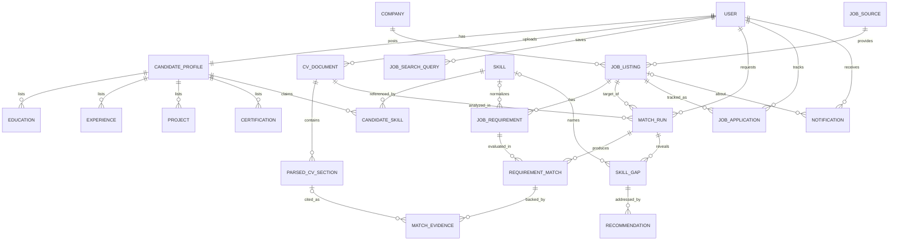

# ER diagram (Mermaid)

Renders on GitHub and in most Markdown viewers. Matches `backend/app/models.py`.

Column details are in `backend/app/models.py`.

## System design (text)
React frontend -> FastAPI backend (auth/profile, CV parsing, JD matching, tracking) -> PostgreSQL + private CV storage.
A separate scheduled discovery worker (search API -> page fetch -> extract -> dedupe -> store) writes job listings into PostgreSQL.
